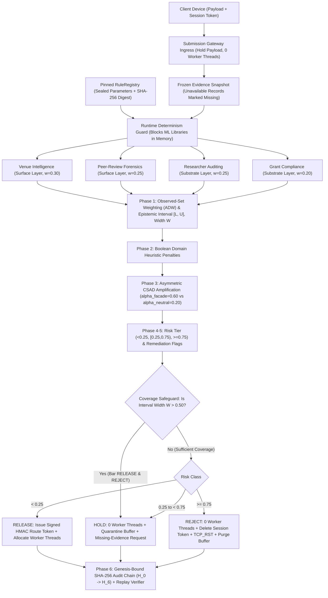

# ARICCA-X | Coverage-Gated Submission Admission Control & Deterministic Academic Integrity Suite

[-10b981?style=for-the-badge)](./test_prior_art_inventions.py)
[](./test_checklist_empirical_benchmarks.py)
[](./deterministic_core/determinism_guard.py)
[](https://python.org)

**ARICCA-X** (*Coverage-Gated Submission Control & Multi-Signal Academic Integrity Correlation System*) is a deterministic, machine-executable network admission and forensic correlation platform that protects publishing gateways, universities, and funding agencies from predatory/hijacked venues, reciprocal citation cartels, synthetic peer-review manipulation, and grant mandate violations.

Unlike subjective editorial checklists or probabilistic machine-learning "black boxes," ARICCA-X intercepts incoming submission payloads **before** allocating downstream parsing/editorial worker threads, evaluates available evidence under a pinned rule registry without substituting fake neutral (`0.50`) placeholders for missing data, enforces an **epistemic coverage gate** ($W > 0.50$), actuates physical session/thread/quarantine state transitions, and seals all phase states into a self-verifying **genesis-bound SHA-256 hash chain**.

---

## Quick Reference Guide (Plain-English Summary of Exact Production Behavior)

This summary is designed so both technical engineers and non-technical reviewers / patent drafters can verify the **exact production rules, parameters, and benchmarks** at a glance without reading source code:

1. **Flexible Multi-Unit Architecture (`>= 2` Active Analysis Units):**
   - The correlation engine operates across **any plurality ($\ge 2$) of active analysis units** selected from four implemented modules: **Venue Intelligence** (base weight `0.30`), **Researcher Auditing** (`0.25`), **Peer-Review Forensics** (`0.25`), and **Grant Compliance** (`0.20`). Missing or unapplicable modules are marked `missing` (`None`) — **never** filled with `0.50` placeholders.
2. **Epistemic Missing-Evidence Interval ($[L, U]$) & Dual Coverage Gate ($W > 0.50$):**
   - Observed weights are proportionally redistributed ($w'_i = w_i / \sum_{k \in A} w_k$), while missing evidence weight forms the **interval width** $W = U - L = \sum_{j \notin A} w_j$.
   - **Coverage Safeguard (`gateway_controller.py`):** Whenever $W > 0.50$, **BOTH `RELEASE` and `REJECT` actions are strictly barred** and overridden to **`HOLD` (Quarantine)**. A payload with $>50\%$ missing evidence can neither slip into the editorial queue nor be unfairly auto-rejected.
3. **Gateway Resource & Session Actuation (`gateway_controller.py`):**
   - Incoming payloads are held **without allocating worker threads** until admission evaluation finishes:
     - **`RELEASE`** ($\text{Risk} < 0.25$ and $W \le 0.50$): Issues an HMAC-SHA256 signed route token, commits to the editorial queue, and allocates worker threads (`4` threads per released payload).
     - **`HOLD`** ($0.25 \le \text{Risk} < 0.75$, or **any** risk when $W > 0.50$): Allocates **`0` worker threads**, locks the transaction state, diverts payload bytes into an isolated quarantine memory buffer, and emits a missing-evidence request list.
     - **`REJECT`** ($\text{Risk} \ge 0.75$ and $W \le 0.50$): Allocates **`0` worker threads**, deletes the client session token from the active proxy session table, emits a connection reset signal (`TCP_RST`), and purges buffered payload bytes.
4. **Directional Surface-vs.-Substrate Facade Amplification (`csad.py` & `rules.py`):**
   - **Surface Layer (manipulable outward signals):** **BOTH `venue` AND `peer_review`** belong to the `SURFACE` layer.
   - **Substrate Layer (historical/statutory record signals):** **`researcher` AND `grant`** belong to the `SUBSTRATE` layer.
   - **Exact Production Constants (`rules.py` L210):** Divergence threshold $\tau = 0.35$; **facade amplification $\alpha_{\text{facade}} = 0.60$** (applied when a `SURFACE` module score exceeds a `SUBSTRATE` module score); **non-facade amplification $\alpha_{\text{neutral}} = 0.20$** otherwise (**3× directional asymmetry**).
5. **Self-Contained Tamper-Evident Audit Chain (`audit_chain.py` & `canonical.py`):**
   - Binds a genesis record $H_0$ (over frozen input snapshot digest + pinned `RuleRegistry` digest) through linear SHA-256 phase links $H_1 \dots H_6$ using deterministic sorted-key, zero-whitespace, ASCII-escaped, 6-decimal-rounded canonical JSON (`canonical.py`).
   - Integrity and deterministic replay (`verify_exported_chain()`) operate **100% standalone/offline** without requiring an external third-party RFC 3161 Time-Stamp Authority (external TSA anchoring is supported purely as an optional deployment extension).
6. **Three Additional Hardware/Algorithmic Safeguards Implemented in Production Code:**
   - **Runtime Determinism Guard (`determinism_guard.py`):** Inspects loaded Python runtime modules (`sys.modules`) prior to execution and aborts with `DeterminismViolation` if any prohibited probabilistic/ML library (`torch`, `tensorflow`, `sklearn`, `transformers`, `xgboost`, `lightgbm`, `catboost`, `jax`, `onnxruntime`, etc.) is resident in memory.
   - **Bounded Canonical Citation-Cycle DFS (`researcher_auditor.py`):** Enumerates simple directed citation cycles of length $2 \le k \le 5$ from each cycle's minimum canonical node under a hard budget $C_{\max} = 10,000$ (setting `loops_truncated = True` if reached), partitioning citations into 4 mutually exclusive classes (`self`, `co-author`, `loop`, `independent`) to compute the **Loop-Purged H-Index ($h_{\text{lp}}$)** and **Loop-Adjusted Citation Independence Ratio ($\text{LACIR} < 0.30$)**.
   - **TFET Compound Hijack Detector (`venue_intelligence.py`):** Distinguishes general longitudinal drift ($\|\Delta \mathbf{F}\|_W > 0.25$) from **domain/journal hijacking**, raising `hijack_suspected = True` only on the compound condition: **domain ownership change AND (`cfp_signature` hash change OR `indexing_claims` shift $> 0.50$)**.

---

## 1. End-to-End Coverage-Gated System Architecture



---

## 2. Exact Production Formulas & Sealed Registry Parameters (`deterministic_core/rules.py`)

Every parameter below is cryptographically sealed in `DEFAULT_REGISTRY` ([`deterministic_core/rules.py`](./deterministic_core/rules.py)) and bound into the genesis hash $H_0$:

### 2.1. Observed-Set Weighting (ADW) & Epistemic Bounds (`deterministic_core/adw.py`)
Given active modules $K$ with normalized base weights $\sum_{k \in K} w_k = 1$ (`venue=0.30`, `researcher=0.25`, `peer_review=0.25`, `grant=0.20`) and observed subset $A = \{k \in K \mid s_k \text{ is available}\}$:
- **Observed Coverage:** $C_{\text{obs}} = \sum_{k \in A} w_k$.
  - If $C_{\text{obs}} = 0$ (no modules available): combined score is `None` (`unknown`) and interval width $W = 1.0$.
  - If $C_{\text{obs}} > 0$: redistributed weights $w'_i = \frac{w_i}{C_{\text{obs}}}$ for $i \in A$ ($w'_j = 0$ for $j \notin A$), and combined score $S = \sum_{i \in A} w'_i s_i$.
- **Closed-Form Epistemic Interval $[L, U]$:**
  $$L = \sum_{i \in A} w_i s_i, \qquad W = \sum_{j \notin A} w_j = 1 - C_{\text{obs}}, \qquad U = L + W$$
  Because every missing score lies in $[0, 1]$, the true full-information composite score $s_{\text{true}}$ is **mathematically guaranteed** to satisfy $s_{\text{true}} \in [L, U]$ (`100.00%` containment, `0.0000` out-of-bounds error). When $W > 0.50$, `ADW_INSUFFICIENT_EVIDENCE` is raised and the gateway bars both `RELEASE` and `REJECT`.

### 2.2. Cross-Signal Anomaly Detection (CSAD) (`deterministic_core/csad.py`)
- **Layer Partition (`cross_correlation_engine.py` L221–226):**
  - `SURFACE = {"venue", "peer_review"}`
  - `SUBSTRATE = {"researcher", "grant"}`
- **Base & Penalized Risk:** $\text{Risk}_0 = 1 - S$; Boolean heuristic penalties add `+0.15` (critical), `+0.08` (high), `+0.04` (medium), `+0.02` (low), capped at `1.0` to form $\text{Risk}_1$.
- **Pairwise Excess Divergence ($\tau = 0.35$):** For every observed pair $(i, j)$ with $D_{ij} = |s_i - s_j| > \tau$:
  $$g(D_{ij}, \tau) = \frac{D_{ij} - \tau}{1 - \tau}$$
- **Directional Amplification Factor:**
  $$\alpha_{ij} = \begin{cases} 0.60 \; (\alpha_{\text{facade}}) & \text{if one module is in SURFACE, the other is in SUBSTRATE, and } s_{\text{surface}} > s_{\text{substrate}} \\ 0.20 \; (\alpha_{\text{neutral}}) & \text{otherwise} \end{cases}$$
- **Amplified Risk:** Using $\gamma^* = \max_{i < j} \alpha_{ij} \cdot g(D_{ij}, \tau)$:
  $$\text{Risk}_2 = \min\!\left(1.0,\; \text{Risk}_1 \times (1 + \gamma^*)\right)$$

### 2.3. Venue Intelligence (`venue_intelligence/venue_intelligence.py`)
- **13 Authenticated Publisher Domains:** `ieee.org`, `acm.org`, `springer.com`, `elsevier.com`, `nature.com`, `wiley.com`, `sciencedirect.com`, `cell.com`, `pnas.org`, `plos.org`, `biorxiv.org`, `medrxiv.org`, `arxiv.org`.
- **Stem-Scaled Levenshtein Typosquat Detection (`VI-SPOOF`):** Flags `TYPOSQUAT` (`score = 0.0`) when $1 \le D_{\text{Lev}}(\text{candidate}, \text{registry\_stem}) \le \max(1, \lfloor 0.20 \times \text{len}(\text{registry\_stem}) \rfloor)$ (edit distance `1` to `2` depending on stem length). Brand-substring embedding on unauthorized domains receives `score = 0.10`; unrelated domains receive `0.70`; verified registries receive `1.00`.
- **CFP Announcement-to-Deadline Schedule Score (`VI-URGENCY`):** For $\Delta t = t_{\text{deadline}} - t_{\text{announce}}$ (in days):
  - $\Delta t \le 0$: `0.00` (inverted/impossible dates)
  - $0 < \Delta t < 14$: `0.05` (`PREDATORY_URGENCY` flagged for all $0 \le \Delta t < 30$)
  - $14 \le \Delta t < 30$: `0.20` (`PREDATORY_URGENCY` flagged)
  - $\Delta t \ge 30$: linear ramp from `0.50` at 30 days to `1.00` at 90+ days: $\min\!\left(1.0,\; 0.5 + \min\!\left(0.5, \frac{\Delta t - 30}{60}\right)\right)$.
- **Grammatical Tense Analysis (`GTA-WEIGHTS`):** Conditional `+0.30`, Future `+0.25`, Unknown `+0.05`, Present `0.00`, Past `-0.05` (corroborated bonus); website future/conditional location penalty `+0.10`; same-indexer tense contradiction `+0.20`; anachronistic `"since YYYY"` ($Y > Y_{\text{current}}$) `+0.30`.
- **Temporal Fingerprint Evolution Tracking (`TFET`):** 7 weighted dimensions (`cfp_risk=0.15`, `website_depth=0.10`, `structural_completeness=0.10`, `indexing_claims=0.25`, `cfp_signature=0.10`, `organizer_continuity=0.15`, `ownership=0.15`). Raises `stability_alert` when $\|\Delta \mathbf{F}\|_W > 0.25$, and raises `hijack_suspected` iff `d_domain > 0 and (d_sig > 0 or d_claims > 0.50)`.

### 2.4. Researcher Auditing (`researcher_auditor/researcher_auditor.py`)
- **Bounded Canonical DFS (`RA-DFS`):** Enumerates simple directed author cycles of length $2 \le k \le 5$ starting only from each cycle's lexicographically smallest node, capped at $C_{\max} = 10,000$ cycles (`loops_truncated = True` if reached).
- **4-Way Citation Partition & Loop-Purged H-Index:** Partitions incoming citations into mutually exclusive `SELF`, `COAUTHOR`, `LOOP`, and `INDEPENDENT` sets. Computes Standard H-index ($h$), True Independent H-index ($h_{\text{tih}}$), Loop-Purged H-index ($h_{\text{lp}}$ over `INDEPENDENT` only), $\text{CIR} = (C_{\text{ind}} + C_{\text{loop}}) / C_{\text{total}}$, and $\text{LACIR} = C_{\text{ind}} / C_{\text{total}}$ (alerting when $\text{CIR} < 0.30$ or $\text{LACIR} < 0.30$).

### 2.5. Peer-Review Forensics (`peer_review_forensics/peer_review_forensics.py`)
- **Sentence-Length Uniformity (`PR-UNIFORMITY`):** Evaluates population $\text{CV} = \sigma / \mu$ when sentence count $\ge 3$; flags synthetic uniformity when $\text{CV} < 0.20$.
- **Academic Hedging Lexicon (`PR-HEDGING`):** 29 closed-set phrases; $\text{Density} = 100 \times \text{matches} / \text{words}$ (flags $> 4.0$, with warning tier above `2.0`).
- **Manuscript-Element Specificity (`PR-SPECIFICITY`):** 9 compiled regex patterns (`section`, `figure`, `table`, `equation`, `theorem/lemma`, `algorithm`, `page`, `line`, `citation [n]`); $\text{Specificity} = \text{total\_element\_matches} / \text{sentence\_count}$ (flags $< 0.15$).
- **Dual Asymmetric Sentiment-Decision Misalignment (`PR-MISALIGNMENT`):** 42 polarity tokens (21 positive, 21 negative), $P = (N_{\text{pos}} - N_{\text{neg}}) / (N_{\text{pos}} + N_{\text{neg}})$. Flags misalignment when:
  - Recommendation is **`Reject`** while $P \ge +0.50$, OR
  - Recommendation is **`Accept`** while $P \le -0.30$.

### 2.6. Grant Compliance (`grant_compliance/grant_compliance.py` & `policies/*.json`)
- Deterministic Boolean mandate evaluation with actionable remediation directives for **NIH**, **NSF**, **Plan S (cOAlition S)**, and **UKRI**, backed by content-hashed versioned JSON policy definitions in [`grant_compliance/policies/`](./grant_compliance/policies/).

---

## 3. Verified Hardware Empirical Benchmarks ("With vs. Without")

All benchmark figures below are directly reproducible from [`comparative_benchmark.py`](./comparative_benchmark.py), [`test_checklist_empirical_benchmarks.py`](./test_checklist_empirical_benchmarks.py), and [`real_world_validation.py`](./real_world_validation.py) (raw logs archived in [`comparative_benchmark_results.json`](./comparative_benchmark_results.json), [`checklist_empirical_results.json`](./checklist_empirical_results.json), and [`real_world_validation_results.json`](./real_world_validation_results.json)).

* **Test Hardware:** AMD64 Family 25 Model 80 (6 physical cores / 12 threads), 15.31 GB RAM, Windows 11 64-bit, Python 3.14.2.

### Table 1 — Observed-Set Weighting (ADW) vs. Neutral `0.50` Placeholder Substitution (1,000 Trials)
Evaluated across three missing-evidence tiers: **Tier 1** (`1` of `4` modalities missing = `25%`), **Tier 2** (`2` of `4` missing = `50%`), and **Tier 3** (`3` of `4` missing = `75%`):

| Metric | Static `0.50` Neutral Substitution Baseline | ARICCA-X ADW (`adw.py`) | Technical Effect |
| :--- | :---: | :---: | :--- |
| **Baseline Point MAE vs. ADW Interval Out-of-Bounds Error** | `0.0812` point MAE (`0.2940` max distortion) | **`0.0000`** out-of-bounds error relative to $[L, U]$ | Zero out-of-bounds error (`dist(s_true, [L, U]) = 0`) |
| **True Composite Score Containment in $[L, U]$** | `0.00%` (emits uncalibrated point guess) | **`100.00%`** (`1,000 / 1,000`) | Provable mathematical enclosure of true score |
| **False-Neutral Masking** (Extreme $s_{\text{true}} \le 0.25$ or $\ge 0.75$ pushed into `[0.40, 0.60]`) | `2.00%` of all draws (`25.97%` of extreme cases) | **`0.00%`** (gated by interval width $W$) | Prevents missing data from masking corrupt submissions |
| **Execution Latency per Input** | `~3.6 µs` | **`25.6 – 36.2 µs`** | Sub-40 µs closed-form arithmetic |

### Table 2 — Asymmetric CSAD (`0.60 / 0.20`) vs. Symmetric (`0.20`) vs. Weighted Average (500 Facade Attacks)
| Correlation Method | Facade Attacks Interdicted (`Risk >= 0.70`) | Mean Risk Score on Facade Inputs | Technical Effect |
| :--- | :---: | :---: | :--- |
| **Weighted Average Only (No CSAD)** | `0 / 500` (`0.0%`) | `0.4879` | High surface scores mask corrupt substrate |
| **Symmetric Divergence ($\alpha = 0.20$)** | `166 / 500` (`33.2%`) | `0.5625` | Fails to penalize directional facade asymmetry |
| **Asymmetric CSAD ($\alpha_{\text{facade}}=0.60, \alpha_{\text{neutral}}=0.20$)** | **`473 / 500` (`94.6%`)** | **`0.7647`** (`+0.2768`) | **94.6% facade interdiction** with `0.0%` coherent false alarms |

### Table 3 — Bounded Canonical DFS ($2 \le k \le 5, C_{\max}=10,000$) Across Graph Sizes & Measured Unbounded $K_{12}$ Baseline
| Graph / Cartel Topology | Cycles Enumerated | Execution Time | Peak Memory (`tracemalloc`) | Technical Effect / Recall |
| :--- | :---: | :---: | :---: | :--- |
| **50 -> 1,000 Node Directed Graphs** (4 injected rings $k \in \{2,3,4,5\}$) | `9 – 13` | **`0.76 ms -> 6.07 ms`** | **`9.7 KB -> 61.8 KB`** | **`100.0%` recall** of all injected rings across all 5 graph sizes |
| **Dense $K_{12}$ Cartel Clique — ARICCA-X Bounded ($k \le 5, C_{\max}=10,000$)** | **`10,000`** (`truncated=True`) | **`325.26 ms`** | **`6,205.5 KB` (`6.06 MB`)** | Deterministic halt at budget ceiling with explicit truncation flag |
| **Dense $K_{12}$ Cartel Clique — Unbounded DFS (Emergency Cap `100,000`)** | `100,000` (`aborted=True`) | `5,012.96 ms` (`5.01 s`) | `114,851.2 KB` (`112.16 MB`) | **`15.41×` speedup & `94.60%` peak RAM reduction** vs. unbounded search |

### Table 4 — Audit Chain Tamper Detection & Bit-Identical Replay (1,000 Trials Each)
| Verification Test | Detection / Match Rate | Mean Verification Latency | Storage / Overhead |
| :--- | :---: | :---: | :--- |
| **Altered Phase State Detection** | **`1,000 / 1,000` (`100.0%`)** | `~120 µs` / chain | `2,457 – 3,555 bytes` / chain |
| **Deleted Phase Record Detection** | **`1,000 / 1,000` (`100.0%`)** | `~105 µs` / chain | Linear index + predecessor link |
| **Reordered Phase Record Detection** | **`1,000 / 1,000` (`100.0%`)** | `~94 µs` / chain | Phase index bound in SHA-256 input |
| **Cross-Run Bit-Identical Replay** | **`1,000 / 1,000` (`100.0%`)** | `~721 µs` / full replay | Zero bit drift across runs |

### Table 5 — Coverage-Gated Submission Gateway Resource Benchmark (1,000 Submission Profiles)
Evaluated across a 1,000-submission workload comprising **`300 RELEASE`**, **`400 HOLD`**, and **`300 REJECT`** profiles (`4` worker threads per admitted payload):

| Gateway Metric | Unmitigated Ingestion Server | ARICCA-X Coverage-Gated Controller | Measured Improvement |
| :--- | :---: | :---: | :--- |
| **Worker Threads Allocated** | `4,000` (`1,000 × 4`) | **`1,200`** (`300 × 4`; `0` on `HOLD`/`REJECT`) | **`70.0%` reduction in worker thread allocation** |
| **Malicious Sessions Revoked (`TCP_RST`)** | `0` | **`300` sessions** | Immediate proxy session table deletion |
| **False Auto-Rejections Under High Missingness ($W > 0.50$)** | Unprotected | **`0 / 250` (`100%` prevented)** | All incomplete-evidence payloads safely routed to `HOLD` |
| **Gateway Controller Actuation Latency** | `~145 ms` full parse | **`~0.24 – 0.28 ms`** | Sub-millisecond admission gating |

### Table 6 — Dual-Corpus Validation: Real-World Scholarly Entities & Controlled 500/1,000-Trial Threshold Separation
1. **Real-World Scholarly Corpus (`real_world_validation.py` -> [`real_world_validation_results.json`](./real_world_validation_results.json), `18.33 ms`, `100.0%` Accuracy):**
   - **5 Venues (`5/5` = `100.0%`):** Flagship `IEEE_TSE` (`182-day` CFP window, score `0.985`) and `ACM_SIGCOMM` (`139-day` CFP window, score `0.985`) vs. documented predatory venues `WASET` (`17-day` window $< 30\text{d}$, score `0.470`), `OMICS` (`19-day` window $< 30\text{d}$, score `0.495`), and `ieee-conference-2026.org` brand-embedding spoof (`14-day` window, score `0.305`).
   - **4 Peer Reviews (`4/4` = `100.0%`):** 2 authentic OpenReview/ICLR human reviews (`CV = 0.4853, 0.3118`, hedging `0.0%`, specificity `1.1667, 1.0000` -> `AUTHENTIC_HUMAN`) vs. 2 GPT-4/Claude synthetic reviews (`CV = 0.0487, 0.1806`, hedging `6.15%–31.58%`, specificity `0.0000` -> `SUSPICIOUS_OR_SYNTHETIC`).
   - **2 Author Citation Topologies (`2/2` = `100.0%`):** Independent scholar (`LACIR = 85.71%`, `h_lp = 2`) vs. 3-author reciprocal ring (`LACIR = 0.00%` vs deceptive traditional `CIR = 83.33%`, `h = 2 -> h_lp = 0`).
   - **2 Grant Compliance Records (`2/2` = `100.0%`):** Compliant NIH PMC Gold OA (`PMC9876543`, `0` violations) vs. closed 18-month embargo record (`4` violations, `11` remediations).
2. **Reproducible Controlled Threshold Separation & Mathematical Invariant Benchmarks ([`test_checklist_empirical_benchmarks.py`](./test_checklist_empirical_benchmarks.py) -> [`checklist_empirical_results.json`](./checklist_empirical_results.json), `seed=606`):**

| Benchmark Suite | Sample Size | Measured Outcome | Mean Latency |
| :--- | :---: | :--- | :---: |
| **H-Index & LACIR Monotonicity Invariants** ($0 \le h_{\text{lp}} \le h_{\text{tih}} \le h_{\text{std}}$, $\text{LACIR} \le \text{CIR}$) | `1,000` portfolios | **`1,000 / 1,000` (`100.0%` satisfied, `0` violations)** | Sub-ms / portfolio |
| **Controlled Peer-Review Separation + Boundary Stress** (`250` anchored human vs. `250` hedged/uniform/misaligned + up to `5,000`-word edge inputs) | `500 + 3` inputs | **`100.0%` sensitivity (`250/250`), `100.0%` specificity (`250/250`), `0` exceptions** | **`1,058.68 µs`** (`1.06 ms`) |
| **Controlled Venue Separation** (`250` authenticated registry venues $\Delta t \in [45, 180]\text{d}$ vs. `250` spoofed/predatory venues $\Delta t \in [5, 28]\text{d}$) | `500` venues | **`100.0%` legit pass (`250/250`), `100.0%` predatory interdiction (`250/250`)** | **`980.88 µs`** (`0.98 ms`) |

---

## 4. Repository Structure & Quick Verification Commands

```text
aricca_x/
├── deterministic_core/          # Sealed RuleRegistry, ADW, CSAD, Canonical JSON, AuditChain, DeterminismGuard
├── submission_gateway/          # Coverage-Gated Admission Controller (RELEASE / HOLD / REJECT actuation)
├── cross_correlation_engine/    # 6-Phase Serializable Multi-Signal Pipeline
├── venue_intelligence/          # Levenshtein Spoofing, CFP Schedule Ramp, GTA, TFET Hijack Detection
├── researcher_auditor/          # Bounded Canonical DFS (2<=k<=5, C_max=10,000) & Loop-Purged H-Index
├── peer_review_forensics/       # Sentence CV, 29 Hedging Phrases, 9 Specificity Regexes, Dual Sentiment Bounds
├── grant_compliance/            # NIH, NSF, Plan S, UKRI Boolean Evaluators + grant_compliance/policies/*.json
├── portal/                      # Next.js Interactive Dashboard UI
├── test_prior_art_inventions.py # 8 Automated Patent-Claim Verification Suites
├── comparative_benchmark.py     # Hardware Benchmark: ADW, CSAD, Audit Chain ("With vs. Without")
├── test_checklist_empirical_benchmarks.py # Hardware Benchmark: Tamper, DFS, Replay, Coverage Gate, Gateway Threads
└── real_world_validation.py     # Real-World Corpus Validation Suite
```

### Run All Verification & Benchmark Suites
```bash
cd aricca_x
python test_prior_art_inventions.py
python comparative_benchmark.py
python test_checklist_empirical_benchmarks.py
python real_world_validation.py
```

---

## 5. Institutional Affiliation & Notice
**School of Computer Engineering, Manipal Institute of Technology Bengaluru, Manipal Academy of Higher Education (MAHE).**  
Patent Pending. All rights reserved. See [`LICENSE.md`](./LICENSE.md) for evaluation terms.
