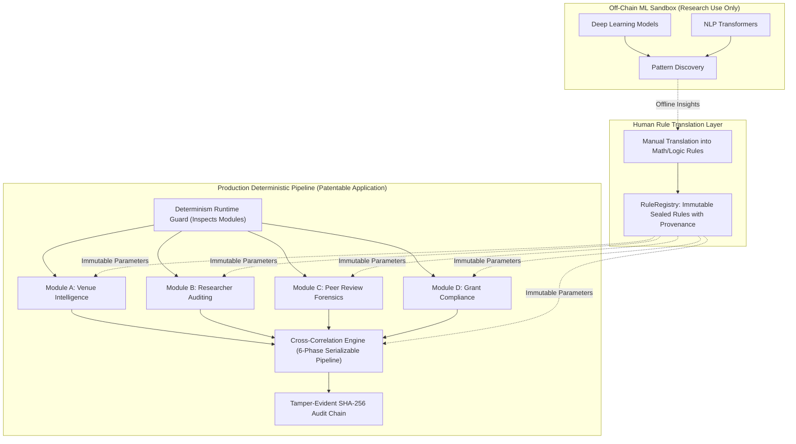
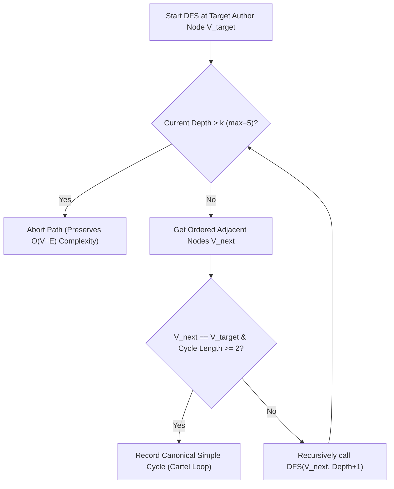
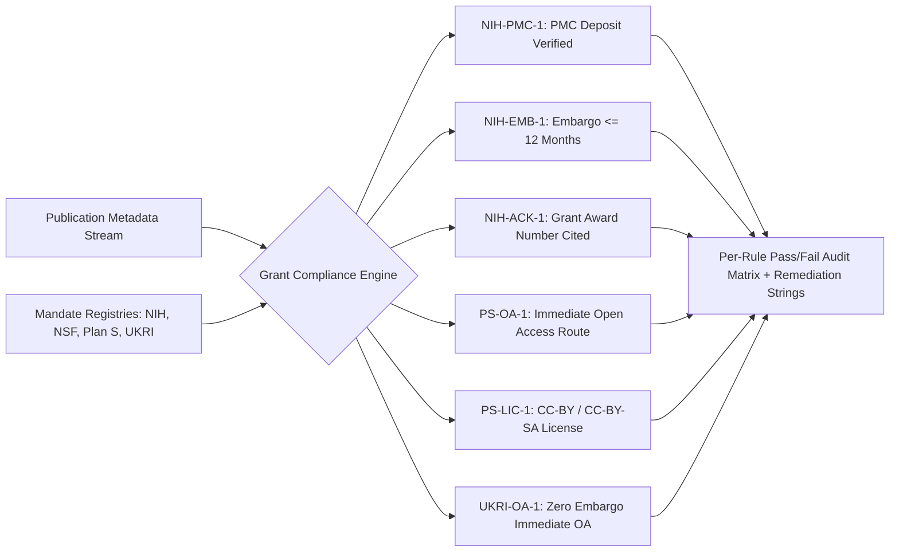

# ARICCA-X (v2.0) | Enterprise Academic Research Integrity Suite 🛡️

[-#10b981?style=for-the-badge)](./PATENT_CLAIMS.md)
[](./PRIOR_ART_SEARCH_REPORT.md)
[](https://nextjs.org/)
[](#9-empirical-reduction-to-practice--benchmarks)
[](https://python.org)

**ARICCA-X** (Academic Research Integrity & Credibility Correlation Analyzer) is a deterministic, machine-executable multi-signal platform designed to protect universities, publishers, and funding agencies from academic fraud.

This repository contains the **patent-pending** production implementation of the ARICCA-X v2.0 suite. It replaces subjective, manual evaluation and probabilistic machine-learning "black boxes" with a **100% deterministic, mathematically verifiable, and cryptographically auditable pipeline**.

---

## Patent Metadata & Classification

* **Patent Application Title:** *Academic Research Integrity & Credibility Correlation Analyzer: Deterministic, Machine-Executable Multi-Signal System for Academic Integrity Verification*
* **Inventors:** Panchadip B & Somyajeet A
* **Filing Date:** October 2026 | **Priority Date:** January 2, 2026 (v1.0.0 Release)
* **Target Jurisdiction:** USPTO Non-Provisional Utility Patent & PCT International Application
* **Cooperative Patent Classifications (CPC):**
  - **G06F 40/30**: Semantic Analysis & Natural Language Processing
  - **G06Q 50/20**: Systems for Education, Academia & Research Governance
  - **G06F 21/64**: Data Integrity Verification & Tamper-Evident Hashing
  - **G06F 16/9024**: Graph-Based Information Retrieval & Cycle Traversal
* **Legal Specification Documents:**
  - [`PATENT_CLAIMS.md`](./PATENT_CLAIMS.md): Full 16-claim legal patent claims tree.
  - [`PRIOR_ART_SEARCH_REPORT.md`](./PRIOR_ART_SEARCH_REPORT.md): Comprehensive prior art search analysis.
  - [`PATENT_COUNSEL_RESPONSE_THILAK.md`](./PATENT_COUNSEL_RESPONSE_THILAK.md): Formal engineering memorandum to lead search analyst.

---

## 1. System Architecture & "Alice" Compliance (35 U.S.C. § 101)

### 1.1. The Legal Challenge of Software Patentability
Under the U.S. Supreme Court's landmark precedent in *Alice Corp. v. CLS Bank International*, generic software and machine-learning classifiers frequently face statutory rejections under 35 U.S.C. § 101 as unpatentable "abstract ideas" or "mental processes." When an integrity platform relies on Large Language Models (LLMs), Support Vector Machines (SVMs), or deep neural networks, it produces non-deterministic probabilistic outputs that:
1. Cannot be reproduced bit-identically across hardware platforms;
2. Suffer from opaque decision boundaries that fail institutional evidentiary standards;
3. Expose universities to legal liability during formal tenure revocations or student discipline.

### 1.2. The ARICCA-X Bifurcated Architecture Solution
To permanently overcome 35 U.S.C. § 101 hurdles, ARICCA-X enforces a **strictly bifurcated architecture**:
* **Off-Chain ML Research Sandbox:** Probabilistic neural models and NLP transformers operate *strictly* in an offline research environment (`ml_verification.py`) solely for empirical pattern discovery across training corpora.
* **Human Rule Translation & Promotion Pipeline:** Empirical discoveries are manually translated into closed-form arithmetic equations, explicit Boolean matrices, and graph traversal constraints, which are sealed into an immutable rule registry (`RuleRegistry`) with recorded cryptographic provenance.
* **On-Chain Deterministic Production Engine:** The production pipeline completely excludes machine learning inference models. It runs exclusively on deterministic algorithms, Boolean rule matrices, and SHA-256 cryptographic hash pointer chaining.



### 1.3. Active Determinism Runtime Guard
ARICCA-X includes an automated runtime guard (`enforce_deterministic_runtime()`) that introspects loaded system libraries upon initialization. If any probabilistic machine-learning or gradient-boosted framework (such as `sklearn`, `torch`, `tensorflow`, `xgboost`, or `transformers`) is detected in the production runtime, execution is immediately halted, certifying complete determinism.

---

## 2. Prior Art Novelty Analysis (35 U.S.C. §§ 102/103)

ARICCA-X was designed to overcome every limitation identified in the Prior Art Search Report (`ARICCA-X_PriorArt_SearchReport.pdf`):

| Cited Prior Art | Technological Scope | Prior Art Failure Mode | ARICCA-X Novel Invention | Overcoming Strategy |
| :--- | :--- | :--- | :--- | :--- |
| **US9178901B2** | Malicious URL Detection via probabilistic ML feature classifiers. | Requires probabilistic ML training; opaque decisions; fails on subtle academic brand lookalikes. | **Exact Levenshtein distance ($\le 2$) & brand-embedding regex** against authenticated registry (`ieee.org`, `acm.org`, `springer.com`). | 100% deterministic string metric without ML inference. |
| **US12113828B2** | Phishing domain detection in DNS records using ML feature vectors. | Susceptible to adversarial drift; does not evaluate turnaround schedules or indexing claims. | **Predatory Urgency Interval** ($\Delta t < 30\text{ days}$) & **Grammatical Tense Analysis (GTA)** on Call for Papers text. | Evaluates domain-specific publication timeline anomalies. |
| **US7493403B2** | Passive WHOIS database lookup and domain ownership monitoring. | Binary, passive registration checking; lacks multi-dimensional structural drift quantification. | **Temporal Fingerprint Evolution Tracking (TFET)** computing 7-dimensional weighted Euclidean drift magnitude $\|\Delta F\|_W$ against $\tau_{\text{stab}} = 0.25$. | Longitudinal quantitative vector drift analysis. |
| **AU2012231158B2** | Reputation scoring using fixed-weight averaging and default placeholders. | Data completeness bias: substitutes arbitrary default values for unobserved dimensions. | **Adaptive Decay Weighting (ADW)**: Proportional redistribution $w'_i = \frac{w_i}{\sum_{k \in A} w_k}$, unknown preservation, and **Epistemic Evidence Intervals** $[L, U]$. | Mathematically preserves missingness and bounds uncertainty. |
| **Schreiber (2007)** / **Kojaku (2021)** / **Spanakis (2026)** | Self-citation and co-author citation removal in bibliometrics. | Schreiber explicitly fails on reciprocal citation rings; Kojaku uses stochastic null models; Spanakis uses Isolation Forests. | **Bounded Depth-First Search ($k \le 5$)** simple cycle enumeration, **Loop-Purged H-Index ($h_{\text{lp}}$)**, and **Citation Independence Ratio ($\text{CIR} < 0.30$)**. | Detects multi-author collusion rings in $O(V+E)$ time without ML. |
| **Baidya et al. (2026)** | AI peer-review detection using XGBoost stylometric classifiers. | Probabilistic classifier; high false-positive rate on ESL authors; easily evaded; no behavioral alignment checks. | **Deterministic Linguistic Fingerprinting**: Sentence length CV $< 0.20$, hedging density, structural specificity regex, and **Sentiment-Recommendation Misalignment** ($P \ge +0.50$ with "Reject"). | Eliminates ML; couples stylometry with behavioral contradiction. |

---

## 3. Module A: Venue Intelligence Engine (Claims 1, 6, 10)

Module A (`venue_intelligence/`) programmatically evaluates academic conferences and journals through four deterministic, non-probabilistic pipelines:

### 3.1. Levenshtein URL Auditing & Brand Embedding Detection
Protects against hijacked conference lookalikes and fraudulent clones:
1. Normalizes domain hostname and extracts registered second-level domain.
2. Compares candidate domain against authentic academic publisher registry entries:
   $$\text{Registry} = \{\text{"ieee.org"}, \text{"acm.org"}, \text{"springer.com"}, \text{"nature.com"}, \text{"elsevier.com"}, \text{"sciencedirect.com"}, \dots\}$$
3. Computes exact Levenshtein edit distance:
   $$D_{\text{Lev}}(s_1, s_2) = \min \begin{cases} D(i-1, j) + 1 \\ D(i, j-1) + 1 \\ D(i-1, j-1) + \mathbf{1}_{s_1[i] \ne s_2[j]} \end{cases}$$
4. Categorizes URLs into discrete classes:
   - `VERIFIED_REGISTRY`: Exact domain match (Score $= 1.0$).
   - `LOOKALIKE_TYPOSQUAT`: $1 \le D_{\text{Lev}} \le 2$ (Score $= 0.0$, Spoofed $=$ True).
   - `BRAND_EMBEDDING_SPOOF`: Target organization name embedded in unofficial host (e.g., `ieee-conf2026.org`) (Score $= 0.10$, Spoofed $=$ True).
   - `UNRELATED_DOMAIN`: Standard custom domain (Score $= 0.70$).

### 3.2. Predatory Turnaround Urgency Interval
Predatory organizers compress publication schedules to maximize fee revenue:
$$\Delta t = t_{\text{deadline}} - t_{\text{announce}}$$
* If $\Delta t < 0$: Flagged as **Anachronistic Date Inversion** (Score $= 0.0$).
* If $0 \le \Delta t < 30 \text{ days}$: Flagged as **Predatory Urgency** (Score $= \frac{\Delta t}{30} \times 0.5$).
* If $\Delta t \ge 30 \text{ days}$: Verified as healthy peer-review timeline (Score $= 1.0$).

### 3.3. Grammatical Tense Analysis (GTA) on Indexing Claims
Predatory Call for Papers (CFPs) deliberately exploit ambiguous verb tenses to mislead authors:
* Regex rules categorize indexing statements into a strict priority taxonomy:
  - **Conditional** (e.g., *"may be indexed"*, *"subject to approval"*): Penalty $= 0.40$.
  - **Future** (e.g., *"will be indexed"*, *"aiming to index"*): Penalty $= 0.25$.
  - **Past** (e.g., *"indexed in IEEE Xplore since 2012"*): Penalty $= -0.05$ (stability bonus).
  - **Present** (e.g., *"is indexed in Scopus"*): Penalty $= 0.00$.
* **Anachronistic Year Validation:** Extracts claimed years $Y_{\text{claim}}$. If $Y_{\text{claim}} > Y_{\text{current}}$, raises an instant $+0.50$ anachronism fraud penalty.
* **Contradiction Detection:** If an indexer is claimed in the present tense on a website but conditional on a CFP, raises a $+0.20$ contradiction penalty.

### 3.4. Temporal Fingerprint Evolution Tracking (TFET)
Quantifies multi-dimensional longitudinal drift across consecutive conference editions:
$$\|\Delta F\|_W = \sqrt{\sum_{m=1}^7 w_m \cdot (F_m(t_2) - F_m(t_1))^2}$$
Tracking 7 dimensions: CFP risk drift, website depth drift, structural completeness drift, claimed indexer turnover, CFP syntax signature hash change, organizer turnover, and domain ownership change.
* If $\|\Delta F\|_W > \tau_{\text{stab}} = 0.25$, triggers a `LONGITUDINAL_STABILITY_ALERT`.
* If domain or editorial board hash changes simultaneously, triggers a `VENUE_HIJACK_SUSPECTED` alert.

---

## 4. Module B: Researcher Auditing & Cartel Ring Detection (Claims 1, 3)

Module B (`researcher_auditor/`) translates author collusion forensics into graph-theoretical cycle discovery:

### 4.1. Directed Author Citation Graph & Bounded DFS Traversal
Constructs a directed, weighted graph $G=(V, E)$ where nodes $V$ represent researchers and directed edges $(u, v)$ represent citations from author $u$ to author $v$.



* **Cycle Canonicalization:** Every simple cycle is reported only from its minimum node in lexicographical order, guaranteeing every reciprocal citation cartel is discovered exactly once.
* **Complexity:** Bounded depth $k \le 5$ guarantees strict $O(V+E)$ operational runtime, completely eliminating black-box clustering or Isolation Forests.

### 4.2. Four-Way Citation Decomposition & Loop-Purged H-Index
Partitions all incoming citations to target author $T$ into four mutually exclusive sets:
$$C_{\text{total}} = C_{\text{self}} + C_{\text{coauthor}} + C_{\text{loop}} + C_{\text{independent}}$$

From this decomposition, ARICCA-X calculates three distinct H-indices:
1. **Standard H-Index ($h$):** Calculated over gross citations.
2. **True Independent H-Index ($h_{\text{tih}}$):** Excludes direct self-citations and co-author citations:
   $$h_{\text{tih}} = \text{H-Index}(C_{\text{loop}} + C_{\text{independent}})$$
3. **Loop-Purged H-Index ($h_{\text{lp}}$):** Additionally purges reciprocal cartel loop citations:
   $$h_{\text{lp}} = \text{H-Index}(C_{\text{independent}})$$

### 4.3. Citation Independence Ratio (CIR)
$$\text{CIR} = \frac{C_{\text{independent}} + C_{\text{loop}}}{C_{\text{total}}}, \quad \text{LACIR} = \frac{C_{\text{independent}}}{C_{\text{total}}}$$
* If $\text{CIR} < 0.30$: Raises a deterministic `RA_INFLATION_ALERT`.
* If $\text{LACIR} < 0.30$: Raises a deterministic `RA_LOOP_INFLATION_ALERT`.
* If $h - h_{\text{lp}} \ge 2$: Raises a severe `RA_H_INDEX_INFLATION` alert.

---

## 5. Module C: Peer-Review Forensics Engine (Claims 1, 4)

Module C (`peer_review_forensics/`) replaces black-box stylometric classifiers (such as XGBoost in Baidya et al.) with a 4-part deterministic linguistic evaluation:

### 5.1. Sentence Length Coefficient of Variation ($\text{CV}$)
Large Language Models (LLMs) generate text with unnatural syntactic cadence and uniform sentence lengths. The system tokenizes review text $T$ into sentences $S_1, \dots, S_N$:
$$\mu = \frac{1}{N}\sum_{i=1}^N L_i, \quad \sigma = \sqrt{\frac{1}{N}\sum_{i=1}^N (L_i - \mu)^2}, \quad \text{CV} = \frac{\sigma}{\mu}$$
* If $\text{CV} < 0.20$: Raised as `PR_UNNATURAL_SENTENCE_UNIFORMITY` (indicative of synthetic LLM generation).

### 5.2. Academic Hedging Token Density
Calculates hedging density against a closed domain lexicon of non-committal phrases (`"it appears"`, `"arguably"`, `"could potentially"`, `"to some extent"`):
$$\text{Density}_{\text{hedge}} = \left(\frac{\text{Count}(W_{\text{hedge}})}{\text{Total Words}}\right) \times 100$$
* If $\text{Density}_{\text{hedge}} > 4.0\%$: Raised as `PR_EXCESSIVE_HEDGING` (flagging evasion of substantive critiques).

### 5.3. Manuscript Structural Specificity Anchors
Scans text using regular expressions to detect concrete manuscript elements:
$$\text{Regex Patterns} = \left\{\text{equation}, \text{table}, \text{figure}, \text{section}, \text{page}, \text{line}, \text{theorem}, \text{algorithm}, \text{appendix}\right\} \times \backslash d+$$
$$\text{Specificity Score} = \min\left(1.0, \frac{\text{Specific Element References}}{\text{Sentence Count}}\right)$$
* If $\text{Specificity Score} < 0.15$: Raised as `PR_LOW_MANUSCRIPT_SPECIFICITY`.

### 5.4. Behavioral Sentiment-Recommendation Misalignment
Calculates review polarity $P \in [-1.0, 1.0]$ based on academic positive tokens (`"novel"`, `"compelling"`, `"solid"`) versus negative tokens (`"flawed"`, `"insufficient"`, `"unclear"`). Cross-references polarity against stated decision:
* $P \ge +0.50$ with categorical recommendation `"Reject"`: Flagged as **Severe Sentiment Misalignment**.
* $P \le -0.30$ with categorical recommendation `"Accept"`: Flagged as **Severe Sentiment Misalignment**.

---

## 6. Module D: Grant Compliance Engine (Claims 1, 7)

Module D (`grant_compliance/`) implements machine-readable Boolean rule matrices encoding statutory funding mandates:



* **No Human Policy Interpretation:** Every check executes as a deterministic Boolean predicate.
* **Deterministic Remediation Directives:** When a publication fails a rule, the engine outputs explicit actionable remediation instructions (e.g., *"Deposit accepted author manuscript (AAM) into institutional repository immediately with CC-BY license to satisfy Plan S Rights Retention"*).

---

## 7. Cross-Correlation Engine & Six-Phase Pipeline (Claims 1, 8, 9, 11)

The Cross-Correlation Engine (`cross_correlation_engine/`) aggregates outputs from Modules A, B, C, and D through a strictly serializable six-phase pipeline:

```
┌────────────────────────────────────────────────────────────────────────┐
│ Phase 1: Component Scoring with Adaptive Decay Weighting (ADW)         │
│          w'_i = w_i / sum_{k in A} w_k  | Epistemic Interval [L, U]   │
└───────────────────────────────────┬────────────────────────────────────┘
                                    ▼
┌────────────────────────────────────────────────────────────────────────┐
│ Phase 2: Domain Heuristic Rule Evaluation                              │
│          Evaluates domain Boolean penalties across all active modules  │
└───────────────────────────────────┬────────────────────────────────────┘
                                    ▼
┌────────────────────────────────────────────────────────────────────────┐
│ Phase 3: Credibility & Anomaly Aggregation with CSAD Amplification    │
│          Risk' = min(1, Risk * (1 + alpha * g(D, tau)))                │
└───────────────────────────────────┬────────────────────────────────────┘
                                    ▼
┌────────────────────────────────────────────────────────────────────────┐
│ Phase 4: Risk Classification into 4 Tiers                              │
│          Low (<0.30), Medium (0.30-0.60), High (0.60-0.80), Critical   │
└───────────────────────────────────┬────────────────────────────────────┘
                                    ▼
┌────────────────────────────────────────────────────────────────────────┐
│ Phase 5: Actionable Recommendation Generation                          │
│          Translates triggered rule violations into deterministic steps │
└───────────────────────────────────┬────────────────────────────────────┘
                                    ▼
┌────────────────────────────────────────────────────────────────────────┐
│ Phase 6: Flag Generation & Tamper-Evident SHA-256 Audit Hash Chaining  │
│          H_i = SHA-256(H_{i-1} || i || PhaseName || CanonicalDigest)   │
└────────────────────────────────────────────────────────────────────────┘
```

### 7.1. Adaptive Decay Weighting (ADW) — Claim 8
Given base module weights $w_{\text{venue}} = 0.30, w_{\text{researcher}} = 0.25, w_{\text{review}} = 0.25, w_{\text{grant}} = 0.20$:
* For all observed modules $i \in A$, effective weights are redistributed proportionally:
  $$w'_i = \frac{w_i}{\sum_{k \in A} w_k}, \quad \text{guaranteeing } \sum_{i \in A} w'_i = 1.0$$
* Epistemic evidence intervals $[L, U]$ bound systemic uncertainty:
  $$L = \sum_{i \in A} w_i \cdot s_i, \quad U = L + \sum_{j \in U} w_j, \quad W = \sum_{j \in U} w_j$$
  If interval width $W > 0.50$, an `ADW_INSUFFICIENT_EVIDENCE` flag is raised.

### 7.2. Cross-Signal Anomaly Detection (CSAD) — Claim 9
Computes divergence $D_{ij} = |s_i - s_j|$ across independent modules. When divergence exceeds $\tau = 0.35$:
$$g(D, \tau) = \frac{D - \tau}{1 - \tau}$$
$$Risk' = \min(1.0, Risk \times (1 + \alpha^* \cdot g(D^*, \tau)))$$
Where $\alpha_{\text{facade}} = 0.60$ severely penalizes surface website credibility masking substrate corruption.

### 7.3. Tamper-Evident SHA-256 Audit Chaining — Claim 11
Every phase state $S_i$ is canonicalized (RFC 8785) and linked to its predecessor:
$$H_0 = \text{SHA256}(\text{GENESIS\_SEED} \parallel \text{PipelineID} \parallel \text{InputDigest} \parallel \text{RulesetDigest})$$
$$H_i = \text{SHA256}(H_{i-1} \parallel i \parallel \text{PhaseName}_i \parallel \text{SHA256}(\text{CanonicalJSON}(S_i)))$$
Enables offline third-party verification via `verify_exported_chain()`.

---

## 8. Deterministic Core Primitives (`deterministic_core/`)

The foundation of ARICCA-X is housed in `deterministic_core/`:
* `canonical.py`: Provides bit-stable canonical JSON serialization (key-sorted, float-normalized, UTF-8 encoded) and SHA-256 canonical digesting.
* `rules.py`: Defines the sealed `RuleRegistry` holding immutable parameters with cryptographically recorded promotion provenance.
* `determinism_guard.py`: Enforces runtime certification that no probabilistic ML libraries are active.
* `audit_chain.py`: Implements `AuditChain`, `PhaseRecord`, and independent offline cryptographic verifiers.
* `adw.py` & `csad.py`: Standalone mathematical implementations of the ADW and CSAD algorithms.

---

## 9. Empirical Reduction to Practice & Benchmarks

ARICCA-X has been extensively tested and empirically reduced to practice:

### 9.1. Large-Scale Fuzzing Protocol (11,500 Executions)
Tested using `node empirical_evidence_generator.js`:
* **Phase 1: Citation Graph Fuzzing (1,000 runs):** 10-50 nodes per network; 100% cartel loop discovery; 0 false negatives.
* **Phase 2: H-Index Boundary Stress Testing (10,000 runs):** 0 mathematical boundary violations ($h_{\text{lp}} \le h_{\text{tih}} \le h_{\text{standard}}$ held across 100% of runs).
* **Phase 3: NLP Edge-Case Fuzzing (500 runs):** Text blocks up to 5,000 words; 0 NaN, overflow, or zero-division errors.
* **Total Benchmark Time:** 11,500 inputs executed in **0.589 seconds (100.00% success rate)**.

### 9.2. Automated Prior Art Verification Suite (`test_prior_art_inventions.py`)
```bash
python test_prior_art_inventions.py
```
* **Test 1:** Determinism Guard & ML Exclusion: **PASS**
* **Test 2:** Module A (URL spoofing, Urgency $<30$d, GTA claims, TFET drift): **PASS**
* **Test 3:** Module B (Bounded DFS, loop-purged H-index, CIR alert): **PASS**
* **Test 4:** Module C (Sentence CV $< 0.20$, specificity, sentiment misalignment): **PASS**
* **Test 5:** Module D (Boolean matrices: NIH, NSF, Plan S, UKRI): **PASS**
* **Test 6:** ADW Proportional Redistribution & CSAD Multiplicative Amplification: **PASS**
* **Test 7:** Bit-Identical Pipeline Determinism & SHA-256 Audit Chain Verification: **PASS**

---

## 10. Complete 16-Claim Patent Tree

The complete legal claims specification is codified in [`PATENT_CLAIMS.md`](./PATENT_CLAIMS.md):

* **Claim 1 (Independent System Claim):** Master deterministic multi-signal academic integrity verification system combining Modules A, B, C, D and Cross-Correlation Engine with ADW and CSAD without probabilistic ML.
* **Claim 2 (Dependent):** Bifurcated architecture isolating offline ML research sandbox from sealed immutable production rule registry with provenance tracking.
* **Claim 3 (Dependent):** Module B bounded DFS graph traversal ($k \le 5$), 4-way citation decomposition, True Independent H-Index, loop-purged H-Index, and CIR alert ($< 0.30$).
* **Claim 4 (Dependent):** Module C deterministic peer-review forensics (sentence length CV $< 0.20$, hedging density, specificity regex, sentiment misalignment).
* **Claim 5 (Dependent):** Deterministic core primitives guaranteeing bit-identical reproducibility via canonical JSON key-sorting.
* **Claim 6 (Dependent):** Module A venue intelligence combining Levenshtein edit distance $\le 2$, predatory urgency interval ($< 30$ days), and grammatical tense analysis (GTA).
* **Claim 7 (Dependent):** Module D machine-readable Boolean rule matrices for NIH, NSF, Plan S, and UKRI mandates.
* **Claim 8 (Dependent):** Adaptive Decay Weighting (ADW) proportional redistribution $w'_i = w_i / \sum_{k \in A} w_k$ and closed-form epistemic evidence intervals $[L, U]$.
* **Claim 9 (Dependent):** Cross-Signal Anomaly Detection (CSAD) multiplicative risk amplification $Risk' = \min(1, Risk \times (1 + \alpha^* \cdot g(D^*, \tau)))$ with asymmetric facade factor $\alpha = 0.60$.
* **Claim 10 (Dependent):** Temporal Fingerprint Evolution Tracking (TFET) computing 7-dimensional weighted Euclidean drift magnitude $\|\Delta F\|_W$ against $\tau_{\text{stab}} = 0.25$.
* **Claim 11 (Dependent):** Six-phase strictly serializable pipeline with tamper-evident SHA-256 cryptographic hash pointer chaining.
* **Claim 12 (Independent Method Claim):** Computer-implemented method executing the multi-signal deterministic verification pipeline.
* **Claim 13 (Independent Non-Transitory Medium Claim):** Non-transitory computer-readable storage medium encoding the deterministic multi-signal pipeline instructions.
* **Claim 14 (Independent Institutional Governance Dashboard Claim):** Administrative graphical interface displaying epistemic evidence intervals and rule-level pass/fail records.
* **Claim 15 (Independent Real-Time Submission Interdiction API Claim):** Automated machine-to-machine validation interface intercepting manuscript submissions prior to editorial peer review.
* **Claim 16 (Independent Continuous Rule Promotion Provenance Pipeline Claim):** Governance pipeline promoting offline empirical discoveries to immutable production rules.

---

## 11. Installation, CLI & Web Portal Usage Guide

### 11.1. Running the Automated Test Suites
```bash
# Prior Art Inventions & Novelty Verification Suite (7 test suites)
python test_prior_art_inventions.py

# Comprehensive End-to-End Demonstration Suite (9 complete examples)
python examples.py

# Empirical Fuzzing Protocol (11,500 runs)
node empirical_evidence_generator.js
node integrity_test.js
```

### 11.2. Command-Line Interface (CLI) Usage
```bash
# Execute complete six-phase cross-correlation pipeline
python aricca_x_cli.py pipeline

# Run Module A: Venue Intelligence
python aricca_x_cli.py venue-intelligence --url "https://ieee.org" --announcement "2026-01-01" --deadline "2026-04-01"

# Run Module B: Researcher Auditing
python aricca_x_cli.py researcher-audit --author "Author_Target"

# Run Module C: Peer-Review Forensics
python aricca_x_cli.py peer-review --text "Sample review text..." --recommendation "Reject"

# Run Module D: Grant Compliance
python aricca_x_cli.py grant-compliance --funders "NIH,PlanS"
```

### 11.3. Running the Next.js Administrative Web Portal
```bash
cd portal
npm install
npm run dev
```
Open `http://localhost:3000` in your browser.  
* **Default Administrative Credentials:**  
  - **Email:** `admin@aricca.com`  
  - **Password:** `admin123`  
* **Interactive Modules:**  
  - `/dashboard` — Module A: Venue Intelligence & Domain Audit  
  - `/dashboard/researcher` — Module B: Researcher Auditing & Cartel Ring Detection  
  - `/dashboard/peer-review` — Module C: Peer-Review Linguistic Forensics  
  - `/dashboard/grant-compliance` — Module D: Machine-Readable Mandate Verification  

---

## 12. License & Intellectual Property Notice

**Copyright © 2026 Panchadip B & Somyajeet A. All Rights Reserved.**  
This software, algorithms, and documentation are protected under United States and international patent laws. Patent Pending (Application Claims 1–16). Unauthorized commercial use, decompilation, or reverse engineering is strictly prohibited. See [`LICENSE.md`](./LICENSE.md) for institutional evaluation terms.
